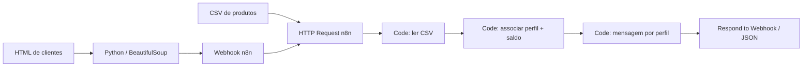
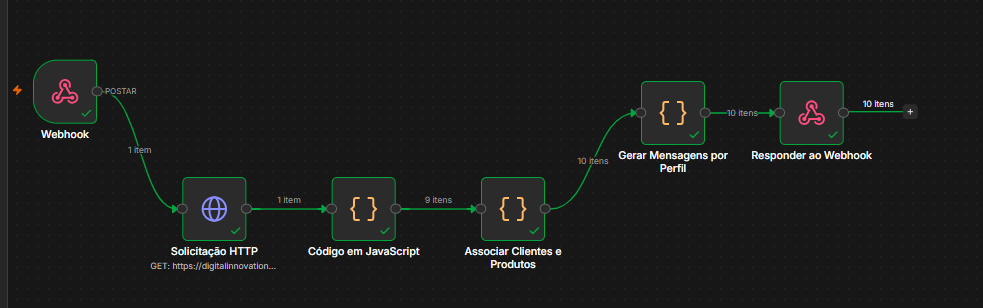

# Assistente de Investimentos com RPA e n8n

**Protótipo educacional | MVP funcional em ambiente local | Santander 2026 / DIO**

Este projeto demonstra como integrar extração automatizada de dados, orquestração de workflows e personalização de mensagens usando informações **inteiramente fictícias**. O sistema lê uma tabela de clientes, cruza o perfil de cada pessoa com produtos de uma base CSV e devolve, via Webhook, mensagens com as opções compatíveis com o saldo disponível. Não executa investimentos nem envia e-mails.

> Projeto desenvolvido como prática do desafio **“Criando um Processo de RPA com N8N e Python”**, a partir do [repositório didático da DIO](https://github.com/digitalinnovationone/dio-lab-assistente-investimentos-rpa-n8n).

## Problema e proposta de valor

Associar manualmente perfis de clientes e critérios mínimos de produtos é repetitivo e sujeito a inconsistências. Este laboratório automatiza a consulta de duas fontes simuladas e aplica regras transparentes, permitindo estudar integração HTTP, tratamento de CSV e composição de mensagens — sem usar dados financeiros reais.

## Solução e funcionalidades implementadas

- **RPA em Python:** coleta nomes, e-mails fictícios, saldos e perfis de uma página HTML pública de demonstração.
- **Webhook n8n:** recebe a lista completa em uma única requisição POST.
- **Consulta de produtos:** lê um CSV público com nove opções distribuídas em três perfis.
- **Regras de elegibilidade:** seleciona produtos do mesmo perfil com mínimo menor ou igual ao saldo normalizado.
- **Mensagens por template:** cria texto individual com nome, perfil, saldo e produtos elegíveis.
- **Resposta JSON:** devolve as mensagens ao Python. Nenhum e-mail é disparado.

**Estado atual:** MVP testado localmente. IA generativa e envio via Gmail **não foram implementados**; pertencem à ampliação demonstrada nas aulas, não ao mínimo com mensagens estáticas.

## Demonstração e resultado observado

O fluxo n8n é:





*Captura do canvas n8n fornecida pelo autor em 22/10/2026. O teste é local e usa dados fictícios; não representa prova de execução em produção.*

Em uma execução local documentada em **22/10/2026**, a amostra fictícia continha **10 clientes**, **9 produtos** e **27 associações elegíveis**. O Python recebeu **HTTP 200** e uma lista JSON com dez mensagens. Esses números descrevem apenas essa amostra e esse ambiente, não desempenho financeiro ou portabilidade universal. Veja [método e resultados](docs/validacao.md) e a [ficha de evidência da execução local](docs/evidencias/execucao-local-2026-10-22.md).

Exemplo de regra: um cliente *Moderado* com saldo fictício de R$ 3.200 recebe CDB Prefixado e Tesouro IPCA+, mas não Fundo Multimercado, cujo mínimo na base é R$ 5.000.

## Quickstart — primeira execução local

**Pré-requisitos:** Python **3.12** com `pip`, n8n local em execução em `http://127.0.0.1:5678` (ambiente testado: n8n **2.41.6**) e acesso à internet para consultar a página e o CSV da DIO.

```powershell
git clone https://github.com/otavio-diniz/dio-lab-assistente-investimentos-rpa-n8n.git
cd dio-lab-assistente-investimentos-rpa-n8n
python -m venv .venv
.\.venv\Scripts\python.exe -m pip install -r requirements.txt
```

No n8n, **importe [n8n/workflow.json](n8n/workflow.json)** como workflow novo. No editor, clique em **Execute workflow** para registrar temporariamente a URL de teste `POST /webhook-test/clientes`. Enquanto o editor aguarda, execute:

```powershell
.\.venv\Scripts\python.exe rpa\extracao_clientes_teste.py
```

Espere `Total de clientes: 10`, `Status HTTP: 200` e um array JSON com dez objetos contendo `opcoes_elegiveis` e `mensagem`. A URL de teste aceita normalmente **uma chamada por acionamento**; reinicie a escuta antes de repetir. **Não é necessário publicar/ativar o workflow**.

Para um clone Linux/macOS ou solução de problemas (erro 404, diferenças de ambiente), consulte o [guia de execução](docs/execucao.md). A execução reproduzível fora do ambiente Windows local testado **não foi verificada**.

## Arquitetura, stack e estrutura

| Componente | Uso comprovado |
| --- | --- |
| Python 3.12, Requests, BeautifulSoup | Web scraping e POST JSON |
| n8n 2.41.6 | Webhook, HTTP Request, três nós Code e resposta |
| JavaScript | Tratamento do CSV, associação e mensagens |
| GitHub Pages | Hospedagem das duas fontes fictícias |
| CSV e JSON | Intercâmbio e normalização de dados |

```text
.
├── README.md
├── NOTICE.md                           # Proveniência e direitos de terceiros
├── requirements.txt
├── rpa/
│   ├── extrair_clientes.ipynb         # Material de partida da DIO
│   └── extracao_clientes_teste.py     # Script executado neste MVP
├── n8n/
│   └── workflow.json                  # Workflow exportado e sanitizado
└── docs/
    ├── index.html                     # Dados fictícios da DIO
    ├── data.csv                       # Produtos fictícios da DIO
    ├── execucao.md                    # Guia detalhado de uso
    ├── validacao.md                   # Resultados e limites da validação
    └── evidencias/
        ├── fluxo-n8n-execucao-2026-10-22.png  # Print autêntico e sanitizado
        └── execucao-local-2026-10-22.md       # Contexto e limites da evidência
```

## Testes, segurança e limitações

A validação positiva abrange a amostra fictícia de dez clientes no Windows com n8n em loopback. A extração, o POST, o CSV, a associação, a personalização por regras e a resposta foram observados ponta a ponta. **Não foram executados testes sistemáticos de entradas malformadas, fontes indisponíveis ou cargas maiores.** Detalhes em [validação](docs/validacao.md).

- Webhook de demonstração sem autenticação, destinado **somente a ambiente local**; não exponha `5678` à internet.
- A versão de teste `/webhook-test/clientes` não é endpoint de produção persistente.
- Google Colab remoto padrão **não consegue acessar** o `127.0.0.1` do computador que hospeda o n8n.
- Valores, taxas, perfis e mensagens são **dados didáticos fictícios**, não orientação de investimento.
- Nenhuma credencial de API, Gmail ou LLM é necessária.
- O CSV possui formato simples; o parser não é um leitor geral de CSV com campos entre aspas.

## Decisões e aprendizados

1. **Execução local** em vez de Colab remoto: mantém Python e n8n no mesmo loopback.
2. **Associação por perfil e mínimo**, sem Merge por posição: são dez clientes e nove opções, conjuntos com granularidades distintas.
3. **Modelos de mensagens estáticas** para um MVP auditável e sem credenciais externas.
4. **Separação de transformação e resposta**: o nó Respond devolve os resultados somente depois da geração das mensagens.

## Extensões possíveis — não implementadas

A trilha *plus* da oficina mostra LLM para variações textuais, padronização de e-mails e integração com Gmail. Esses recursos requerem configuração, consentimento, validação de destinatários e avaliação de segurança separados. **Não são parte da funcionalidade publicada neste repositório.**

## Contexto acadêmico, certificação e reconhecimento

Este repositório é o **fork de um laboratório didático** do desafio **“Criando um Processo de RPA com N8N e Python”**, do **Bootcamp Santander 2026 — Automação com n8n**, ofertado no ecossistema educacional da **Digital Innovation One (DIO)**. A implementação e a documentação complementares deste MVP foram realizadas por **Otávio Diniz** a partir dos materiais de partida da DIO.

A realização acadêmica tem **certificação institucional**: certificado do desafio de projeto **CKTPBZWK** (22/10/2026) e certificado de conclusão do bootcamp **HOMGSHSI**. A certificação diz respeito à atividade e ao programa; não constitui homologação independente de robustez, segurança, portabilidade ou adequação ao uso produtivo deste protótipo. Os documentos pessoais originais permanecem fora do repositório público.

**Reconhecimento:** agradeço à [Digital Innovation One — @digitalinnovationone](https://github.com/digitalinnovationone) e ao [Santander Open Academy](https://www.santanderopenacademy.com/pt_br/index.html) pela oportunidade formativa e pelo contexto educacional deste desafio. A referência a essas instituições registra origem e reconhecimento: **não implica endosso técnico desta implementação, parceria comercial ou vínculo profissional**. O [laboratório original da DIO](https://github.com/digitalinnovationone/dio-lab-assistente-investimentos-rpa-n8n) é a fonte didática e de proveniência.

**Autoria e direitos:** a extração inicial em notebook, a página HTML e o CSV provêm do fork de origem; o script integrado, o workflow exportado e a documentação complementar identificam a evolução realizada neste projeto. Os arquivos de origem e as contribuições não devem ser tratados como se tivessem um único titular ou uma licença única. Consulte [NOTICE.md](NOTICE.md) para a relação entre componentes originais, alterações e limites de direitos.

**Licenciamento:** não foi localizada uma licença explícita na raiz do repositório de origem consultado. Este fork não cria uma licença nova para os arquivos da DIO, tampouco pressupõe autorização de redistribuição comercial. Qualquer licenciamento definitivo exige conciliação dos direitos dos componentes afetados.

